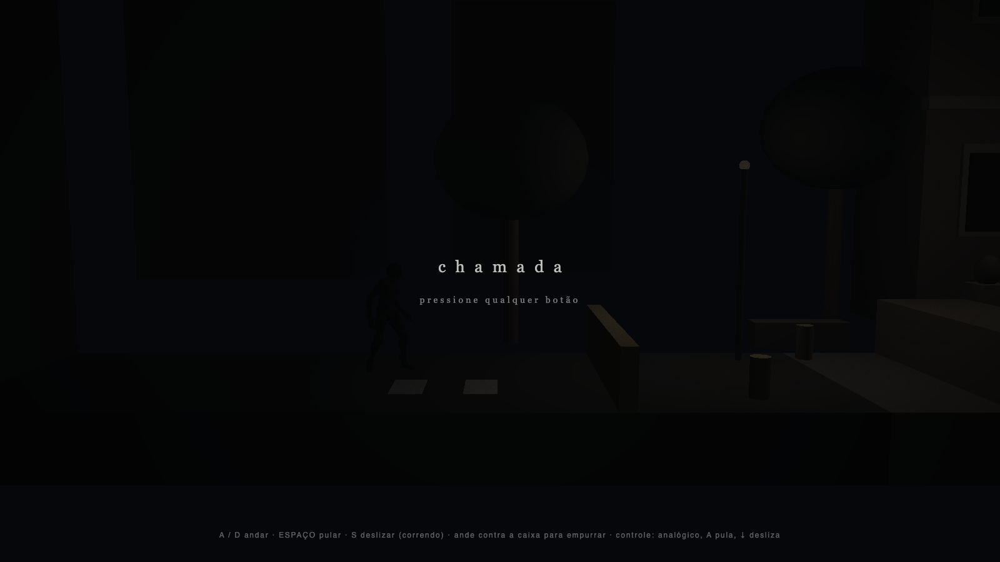
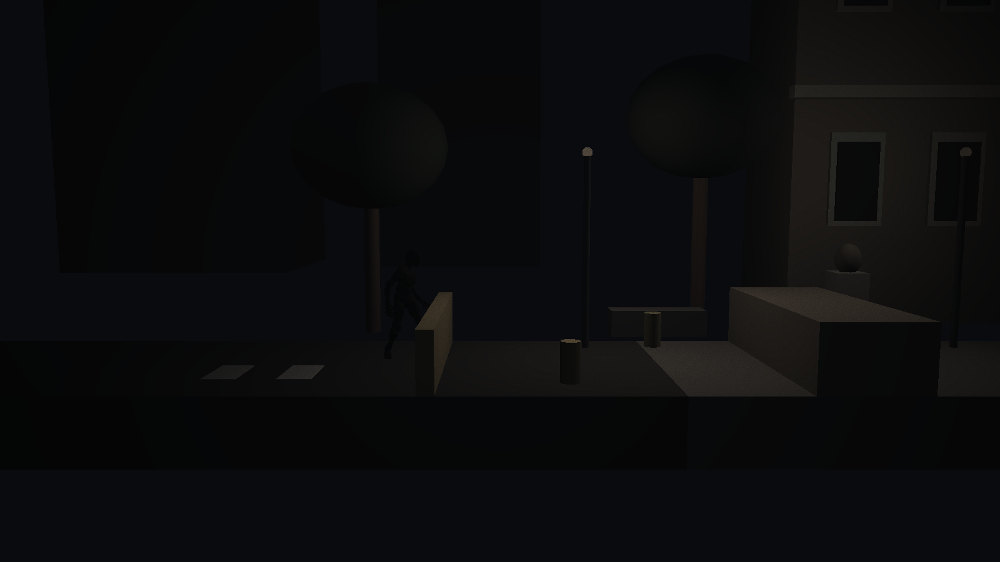

<div align="center">

# c h a m a d a

*Chegue à sala antes que o alto-falante chame o seu nome.*




</div>

## Sobre o jogo

**Chamada** é um jogo de plataforma e puzzle 2.5D, de cerca de cinco minutos, que roda no navegador. Um aluno sem rosto atravessa uma universidade vazia e sombria, à noite, para chegar à sala de aula antes que a chamada termine.

Não há barra de tempo. **O relógio é a própria chamada:** uma voz de alto-falante lê nomes em ordem alfabética, e o seu é o último. Ela começa abafada e distante no pátio e fica cada vez mais próxima conforme você avança. Morrer não para a voz.

<p align="center">
  
</p>

### Pilares

| | |
| --- | --- |
| 🔊 **A pressão é sonora** | O tempo é a voz da chamada, não um número na tela. |
| 🤫 **Mundo sem palavras** | Sem diálogos e sem texto no jogo, fora do menu. |
| 💀 **Morte barata** | Reinício instantâneo no início da área. |
| 🌫️ **Clima antes de quantidade** | Poucas áreas, bem acabadas, com névoa, grão e luzes quentes contra um fundo frio. |

## O caminho até a sala

| | Área | O que acontece |
| :-: | --- | --- |
| 1 | **Pátio** | O portão principal está fechado. Empurre uma caixa e ache outro caminho. |
| 2 | **Corredor do bloco principal** | Luzes falhando, uma catraca baixa e uma placa de pressão. |
| 3 | **Biblioteca** | O Vigia patrulha com a lanterna. Fique fora da luz. |
| 4 | **Subsolo** | O Vigia persegue. Pule, deslize e não olhe para trás. |
| 5 | **Corredor final** | Silêncio, e o seu nome chegando. |

## Controles

| Ação | Teclado | Controle |
| --- | --- | --- |
| Andar | `A` / `D` ou setas | Analógico esquerdo ou direcional |
| Pular | `Espaço` | `A` (Xbox) / `X` (PlayStation) |
| Deslizar | `S` ou `↓` enquanto corre | Analógico para baixo enquanto corre |
| Empurrar caixa | Andar contra a caixa | Andar contra a caixa |

## Como rodar

Você precisa do [Node.js](https://nodejs.org) 20 ou mais recente.

```bash
npm install
npm run dev
```

Abra `http://localhost:5173` e pressione qualquer botão. O servidor também escuta na rede local, então dá para abrir no celular pelo IP do computador (com um controle bluetooth).

<details>
<summary><b>Versão final, testes e fase de teste</b></summary>

<br>

Gerar e servir a build:

```bash
npm run build
npx vite preview --port 4173
```

O `index.html` da build não abre com duplo clique, porque o navegador bloqueia o carregamento de modelos e sons fora de um servidor local.

Rodar os testes automáticos da lógica:

```bash
npm test
```

Há uma fase de testes em `http://localhost:5173/?fase=teste`.

</details>

## Estrutura do projeto

```
chamada/
├── src/
│   ├── game/        núcleo: jogador, câmera, física, Vigia, portas, caixas, pós-processamento
│   ├── levels/      as cinco áreas descritas em dados, separadas do código
│   └── ui/          menu, transições e tela final com créditos
├── public/          modelos GLB e sons usados pelo jogo
├── ferramentas/     script do Blender que converte os FBX do Mixamo para GLB
├── tests/           testes com node --test
├── Chamada GDD enxuto.md   documento de design
└── PROJETO.md       contexto técnico, estado atual e licenças dos assets
```

## Equipe

Feito por **João Leal**, **Murilo Schettino**, **Gustavo Lopes** e **Eduardo Millione** para a disciplina de Desenvolvimento de Jogos Digitais.

## Créditos e licenças

- Motor: [Babylon.js](https://www.babylonjs.com) e física [Havok](https://www.havok.com)
- Personagens e animações: [Mixamo](https://www.mixamo.com) (Adobe), usados conforme os termos do serviço
- Referências de clima e ritmo: *INSIDE* e *SpeedRunners*

A lista completa de assets, com origem e licença de cada um, está na seção 9 do [`PROJETO.md`](PROJETO.md).
